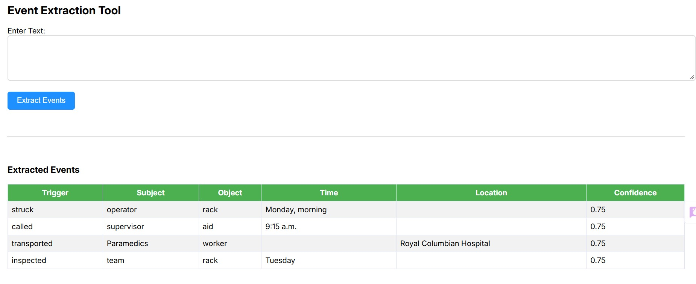

# Event Trace Extractor

A web-based tool for extracting structured narrative events from text, including triggers, entities, temporal information, and locations.

## Features

- **Event Detection:** Identifies action verbs and narrative triggers
- **Entity Extraction:** Captures subjects and objects from text
- **Temporal Tagging:** Extracts time references
- **Location Detection:** Identifies spatial settings
- **Confidence Scoring:** Rates event completeness (0.0 - 1.0)
- **Web Interface:** Interactive UI for real-time event extraction

## Installation

```bash
# Clone the repository
git clone https://github.com/ruthyankson/event_trace_extractor.git
cd event_trace_extractor

# Create virtual environment
python -m venv venv
source venv/bin/activate  # Windows: venv\Scripts\activate

# Install dependencies
pip install -r requirements.txt

# Download spaCy model
python -m spacy download en_core_web_sm
```

## Usage

```bash
# Start the server
uvicorn main:app --reload

# Open browser to http://localhost:8000
```

## Example

**Input:**

```sh
"John walked to the park yesterday. He met Sarah at noon".
```

**Output:**

```json
[
  {
    "trigger": "walked",
    "subject": ["John"],
    "object": [],
    "time": ["yesterday"],
    "location": ["park"],
    "confidence": 0.75
  },
  {
    "trigger": "met",
    "subject": ["He"],
    "object": ["Sarah"],
    "time": ["noon"],
    "location": [],
    "confidence": 0.75
  }
]
```

## Confidence Scoring

Confidence is calculated based on how many event fields contain data:

- 4/4 fields filled = 1.0
- 3/4 fields filled = 0.75
- 2/4 fields filled = 0.5
- 1/4 fields filled = 0.25

Fields: subject, object, time, location

### Example Usage



## Dependencies

- fastapi
- uvicorn
- jinja2
- python-multipart
- spacy

## License

This project is released under the MIT License. See the [LICENSE](LICENSE) file for details.
